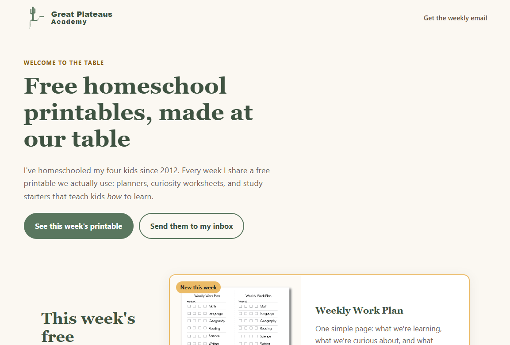

# Great Plateaus Academy — Landing Page

A fast, accessible, zero-dependency landing page for **Great Plateaus Academy**, an inquiry-based homeschool brand. Visitors download a free weekly printable and join the newsletter. The site is hosted on a private S3 bucket behind CloudFront and deployed automatically by GitHub Actions using keyless OIDC authentication.
 
**🔗 Live site:** [greatplateausacademy.com](https://greatplateausacademy.com)
 


## Table of contents
 
- [Features](#features)
- [Tech stack](#tech-stack)
- [Key decisions](#key-decisions)
- [Getting started](#getting-started)
- [Accessibility](#accessibility)
- [Project structure](#project-structure)
- [Roadmap](#roadmap)
- [What I learned](#what-i-learned)
- [Author](#author)
- [License](#license)


## Features
 
- **Weekly free printable** — a featured download card, an "upcoming" row and an archive of previous printables.
- **Newsletter signup** — a custom-styled HTML form with client-side validation, posting to Kit (formerly ConvertKit) with double opt-in.
- **Accessible by design** — targets WCAG 2.2 AA: skip link, visible labels, linked error messages, screen-reader text on download links and a contrast-checked color palette.
- **Responsive** — mobile-first layout built with CSS Grid and Flexbox.
- **Custom 404 and thank-you pages** that match the brand.
- **Automated deploys** — every push to `main` publishes the site and clears the CDN cache in about a minute.
- **No build step** — plain HTML, CSS and JavaScript. Nothing to install, nothing to compile.

## Tech stack
 
| Layer | Technology |
|---|---|
| Front end | HTML5, CSS3 (custom properties, Grid, Flexbox), vanilla JavaScript |
| Fonts | Fraunces and Nunito Sans (Google Fonts) |
| Hosting | Amazon S3 (private) + Amazon CloudFront |
| DNS and TLS | Amazon Route 53, AWS Certificate Manager |
| CI/CD | GitHub Actions with OIDC (no stored AWS keys) |
| Newsletter | Kit inline form |
| Domain email | Proton Mail, with SPF, DKIM and DMARC |

## Key decisions
 
**Static site, no framework.** The page is a single landing page with one form. Plain HTML, CSS and JavaScript keep it fast, easy to maintain and free of dependency updates. I'm comfortable with Next.js, but it would add a build pipeline without adding value here.
 
**Private S3 bucket + CloudFront with Origin Access Control.** The bucket blocks all public access. Only CloudFront can read it, which means HTTPS everywhere, edge caching and no accidental public bucket exposure.
 
**Keyless CI/CD with OIDC.** GitHub Actions requests a short-lived token for each run instead of storing long-lived AWS access keys as secrets. The IAM role trusts only this repository's `main` branch and has least-privilege permissions: upload to one bucket and invalidate one distribution.
 
**Two-tier caching strategy.** HTML is uploaded with `Cache-Control: no-cache` so content changes appear immediately. Static assets (CSS, JS, images, PDFs) are cached for one day. The CloudFront cache is invalidated on every deploy.
 
**Using a service for email instead of building it.** Collecting an address is easy; deliverability, unsubscribe compliance (CAN-SPAM), double opt-in and bounce handling are not. Kit handles those, while downloads are served directly from S3 at no extra cost.
 
**Email authentication from day one.** The domain publishes SPF, DKIM and DMARC records, and Kit uses a verified sending domain so newsletters aren't flagged as sent "via" a third party.

## Accessibility
 
Accessibility was treated as a requirement, not an afterthought:
 
- Every brand color was checked against **WCAG 2.2 AA** contrast ratios (4.5:1 for text, 3:1 for large text and UI). Colors that failed as text, like the brand gold and turquoise, are used only as backgrounds, with darker text-safe shades defined for each.
- A skip link, semantic landmarks and a logical heading order support keyboard and screen-reader users.
- Form fields have visible labels, and validation errors are announced and linked to their inputs.
- Download links include visually hidden text naming the specific printable, so link text is never ambiguous out of context.
- Decorative SVGs are hidden from assistive technology with `aria-hidden="true"`.
<!-- Optional: add your Lighthouse scores here once the site is live, e.g.
| Performance | Accessibility | Best Practices | SEO |
|---|---|---|---|
| 100 | 100 | 100 | 100 |
-->


## Project structure
 
```
.
├── .github/workflows/
│   └── deploy.yml                  # CI/CD: S3 sync + CloudFront invalidation
├── aws/
│   ├── github-trust-policy.json    # OIDC trust, scoped to this repo's main branch
│   └── github-deploy-permissions.json  # least-privilege deploy permissions
├── docs/
│   ├── MAINTENANCE.md              # setup, infrastructure and weekly update guide
│   └── screenshot.png
├── site/                           # deployed web root
│   ├── index.html
│   ├── thanks.html
│   ├── 404.html
│   ├── styles.css
│   ├── main.js
│   ├── downloads/                  # printable PDFs
│   └── images/
└── README.md
```

## Roadmap
 
[ ] Content Security Policy and security headers via a CloudFront response headers policy

[ ] Privacy-friendly analytics for page visits and download counts

[ ] Printable archive page with filtering by subject and grade

[ ] Directory of recommended subject experts and books

[ ] Automated accessibility checks (axe or Pa11y) in the CI pipeline


## What I learned
 
- Configuring **GitHub OIDC federation with AWS IAM** to eliminate long-lived credentials from CI/CD.
- Securing static hosting with **CloudFront Origin Access Control** and handling the S3 403-as-404 behavior with custom error responses.
- Designing a **cache strategy** that balances instant content updates with CDN performance.
- Building an **accessible color system** from brand colors by testing contrast and deriving text-safe shades.
- Setting up **email authentication** (SPF, DKIM, DMARC) and its impact on newsletter deliverability.


## Author
 
**Melissa Kipp** — Founder, Great Plateaus Academy
 
- Portfolio: [Melissa J Kipp](https://www.melissajkipp.com/)
- LinkedIn: [linkedin.com/in/melissajkipp](https://www.linkedin.com/in/melissajkipp/)
- GitHub: [@melissakipp](https://github.com/melissakipp)

## License
 
The source code is available under the [MIT License](LICENSE).
 
Brand assets — the Great Plateaus Academy name, logo, copy and printable PDFs — are © 2026 Great Plateaus Academy, all rights reserved, and are not covered by the MIT License.